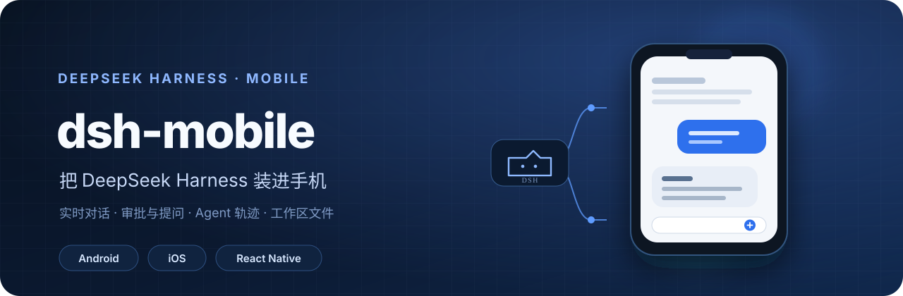
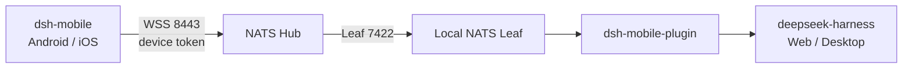

<div align="center">

[简体中文](README.md) · **English**



# dsh-mobile

**A native Android and iOS client for DeepSeek Harness.**

Scan a pairing code to connect to your running dsh instance and continue the same conversation on your phone. View streamed responses, reasoning, tool calls, subagents, approvals, and agent trajectories.

<p>
  <a href="https://github.com/EarhartZhao/dsh-mobile/releases/latest"></a>
  <a href="https://github.com/EarhartZhao/dsh-mobile/actions/workflows/ci.yml"></a>
  
  
  
</p>

[Download](https://github.com/EarhartZhao/dsh-mobile/releases/latest) · [Install the plugin](https://github.com/EarhartZhao/dsh-mobile-plugin) · [Setup guide](https://github.com/EarhartZhao/dsh-mobile-plugin/blob/master/docs/04-ai-onboarding.md) · [Documentation](docs/)

</div>

## What is dsh-mobile?

dsh-mobile is not another AI client. It is a mobile view of DeepSeek Harness. The authoritative session log stays inside the dsh process, so the desktop Web UI and the phone see the same conversations, queues, jobs, approvals, and questions in real time.

The connection path is simple: the phone connects to a NATS Hub over WSS, the Hub connects to the NATS Leaf running on your computer, and the plugin bridges requests and events into dsh. Your computer does not need a public IP address or an inbound port.



## Features

| Conversations | Jobs and agents | Mobile experience |
| --- | --- | --- |
| Streamed responses, Markdown, and code blocks | Approvals, questions, queues, and interruption | QR pairing and multiple saved connections |
| Reasoning, tool calls, and result cards | Subagent catalog and standalone sessions | Images, files, and workspace references |
| Paged long conversations and reconnect recovery | Jobs, plans, goals, and session statistics | Light/dark themes and Chinese/English UI |
| Message feedback, branching, retry, and search | Trajectory list, search, details, and progress | In-app Android updates |

The UI tracks the dsh Web experience, including user messages, assistant messages, reasoning, the composer, and session statistics, instead of introducing a separate chat design.

## Quick start

### 1. Install the app

Open [GitHub Releases](https://github.com/EarhartZhao/dsh-mobile/releases/latest):

- **Android**: Download `DshMobile-*-release.apk`. If you are moving from a debug-signed build, uninstall it once first. Later releases can be checked and installed from the app settings.
- **iOS**: Releases include an unsigned IPA for self-signing tools. You can also build from source and run it on a simulator or device.

### 2. Install the plugin on your computer

Install and enable this package from the dsh **Plugins** page:

```text
@dsh-earhartzhao/dsh-mobile-plugin
```

The plugin handles pairing, device tokens, the NATS bridge, and access control. See [dsh-mobile-plugin](https://github.com/EarhartZhao/dsh-mobile-plugin) for Hub and CA setup.

### 3. Pair your phone

Open the plugin settings and follow the on-screen checklist:

1. Enter the Hub URL, account, and password.
2. Fetch or paste the Hub CA certificate.
3. Start the local NATS Leaf.
4. Generate a pairing QR code and scan it in the app.

If this computer does not have `nats-server` or `leaf.conf` yet, give the [AI onboarding checklist](https://github.com/EarhartZhao/dsh-mobile-plugin/blob/master/docs/04-ai-onboarding.md) to the assistant running on that computer.

> App `0.1.7` supports plugin `>=0.2.2 <0.3.0`. If the versions or required capabilities do not match, the app reports the exact incompatibility during connection instead of failing silently.

## Run from source

Requirements: Node.js 22+, pnpm 11, and JDK 17. iOS builds also require Xcode 26+.

```bash
pnpm install

# Shared packages
pnpm --config.verify-deps-before-run=false run typecheck
pnpm --config.verify-deps-before-run=false run test
pnpm --config.verify-deps-before-run=false run sync-protocol:check

# Mobile app
cd apps/mobile
pnpm --config.verify-deps-before-run=false run typecheck
pnpm --config.verify-deps-before-run=false run lint
pnpm --config.verify-deps-before-run=false run test
```

Android:

```bash
cd apps/mobile/android
./gradlew assembleDebug
```

iOS:

```bash
cd apps/mobile/ios
pod install
open DshMobile.xcworkspace
```

Run on a simulator from the command line:

```bash
pnpm --dir apps/mobile start
xcrun simctl boot 'iPhone 17'
xcrun simctl install booted /path/to/DshMobile.app
xcrun simctl launch booted com.dshmobile
```

An Android release build requires signing configuration. Local smoke tests may use `-PallowDebugSignedRelease=true`, but that build must not be distributed.

## Repository layout

```text
dsh-mobile/
├── apps/mobile/       # React Native UI and native Android/iOS projects
├── packages/core/     # Connection, session, projection, and compatibility logic
├── packages/protocol/ # dsh API contracts and NATS client
├── docs/              # Architecture, protocol, testing, and feature-gap notes
└── scripts/           # Protocol sync, release, and UI automation scripts
```

The protocol layer is synchronized from dsh and frozen under `packages/protocol/src/vendor/`. Run `pnpm run sync-protocol:check` before changing protocol code; do not edit vendor files directly.

## Documentation

The detailed design and engineering documents are currently maintained in Chinese:

- [Architecture](docs/00-overview.md): network topology, NATS design, synchronization, and risks
- [Technology stack](docs/01-tech-stack.md): React Native, native modules, and iOS integration
- [Protocol](docs/02-protocol.md): request/response envelopes, event streams, and compatibility
- [Build plan](docs/03-build-plan.md): milestones and acceptance criteria
- [Feature gap](docs/04-feature-gap.md): capability comparison with the dsh Web UI
- [Test plan](docs/05-test-plan.md): feature matrix, device acceptance, and regression coverage

## Release process

Pushing a `v*` tag triggers GitHub Actions to run protocol synchronization checks, type checks, tests, and lint, build a signed Android APK, and attach an unsigned iOS IPA. See [AGENTS.md](AGENTS.md) and `skills/` for the release workflow.
