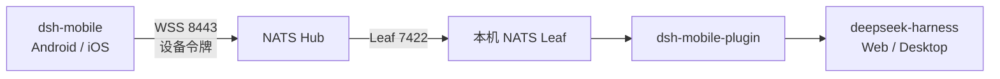

<div align="center">

**简体中文** · [English](README.en.md)


# dsh-mobile

**DeepSeek Harness 的 Android / iOS 移动客户端。**

扫码连接你正在运行的 dsh，在手机上继续同一个会话，查看实时回复、思考过程、工具调用、子智能体、审批与 Agent 轨迹。

<p>
  <a href="https://github.com/EarhartZhao/dsh-mobile/releases/latest"></a>
  <a href="https://github.com/EarhartZhao/dsh-mobile/actions/workflows/ci.yml"></a>
  
  
  
</p>

[下载 App](https://github.com/EarhartZhao/dsh-mobile/releases/latest) · [安装插件](https://github.com/EarhartZhao/dsh-mobile-plugin) · [连接教程](https://github.com/EarhartZhao/dsh-mobile-plugin/blob/master/docs/04-ai-onboarding.md) · [设计文档](docs/)

</div>

## 它是什么

dsh-mobile 不是另一套 AI 客户端，而是 DeepSeek Harness 的移动视图。会话数据仍然只有 dsh 进程里的那一份，电脑 Web 端和手机端实时看到同一份会话、队列、任务、审批与提问。

链路很短：手机通过 WSS 连接 NATS Hub，Hub 通过 Leaf 连接你电脑上的 NATS，插件再把请求和事件桥接给 dsh。电脑不需要公网 IP，也不需要开放入站端口。



## 主要能力

| 对话 | 任务与 Agent | 移动端 |
| --- | --- | --- |
| 实时流式回复、Markdown 与代码块 | 审批、提问、队列与打断 | 扫码配对、多连接切换 |
| 思考过程、工具调用与结果卡片 | 子智能体目录与独立会话 | 图片、文件与工作区引用 |
| 长会话分页加载与断线恢复 | 任务、计划、目标与会话统计 | 浅色/深色主题、中英文 |
| 消息反馈、分叉、重发与搜索 | 轨迹列表、搜索、详情与进度 | Android App 内更新 |

界面持续对齐 dsh Web 端，包括用户消息、AI 消息、思考过程、输入框和会话统计，而不是另做一套聊天 UI。

## 快速开始

### 1. 安装 App

前往 [GitHub Releases](https://github.com/EarhartZhao/dsh-mobile/releases/latest)：

- **Android**：下载 `DshMobile-*-release.apk`。首次安装若来自 debug 签名版本，需要先卸载一次；之后可在 App 设置页直接检查并覆盖更新。
- **iOS**：Release 提供未签名 IPA，适合使用自签名工具安装；也可以从源码构建并运行到模拟器或真机。

### 2. 在电脑端安装插件

在 dsh 的「插件」页安装并启用：

```text
@dsh-earhartzhao/dsh-mobile-plugin
```

插件负责配对、设备令牌、NATS 桥接和权限控制。完整安装、Hub 与 CA 配置见 [dsh-mobile-plugin](https://github.com/EarhartZhao/dsh-mobile-plugin)。

### 3. 配对手机

打开插件配置页，按页面顺序完成：

1. 填写 Hub 地址、账号和密码。
2. 获取或粘贴 Hub CA 证书。
3. 启动本机 NATS Leaf。
4. 点击「生成配对二维码」，在 App 中扫码。

新电脑还没有 `nats-server` 或 `leaf.conf` 时，直接把 [AI 接入清单](https://github.com/EarhartZhao/dsh-mobile-plugin/blob/master/docs/04-ai-onboarding.md)交给这台电脑上的助手执行即可。

> App `0.1.7` 支持插件 `>=0.2.2 <0.3.0`。两端版本不兼容时，App 会在连接阶段直接说明缺少的能力，不会静默失败。

## 从源码运行

需要 Node.js 22+、pnpm 11、JDK 17；iOS 还需要 Xcode 26+。

```bash
pnpm install

# 共享层检查
pnpm --config.verify-deps-before-run=false run typecheck
pnpm --config.verify-deps-before-run=false run test
pnpm --config.verify-deps-before-run=false run sync-protocol:check

# App 检查
cd apps/mobile
pnpm --config.verify-deps-before-run=false run typecheck
pnpm --config.verify-deps-before-run=false run lint
pnpm --config.verify-deps-before-run=false run test
```

Android：

```bash
cd apps/mobile/android
./gradlew assembleDebug
```

iOS：

```bash
cd apps/mobile/ios
pod install
open DshMobile.xcworkspace
```

也可以从命令行启动模拟器：

```bash
pnpm --dir apps/mobile start
xcrun simctl boot 'iPhone 17'
xcrun simctl install booted /path/to/DshMobile.app
xcrun simctl launch booted com.dshmobile
```

正式 Android Release 必须有签名配置；本地冒烟可使用 `-PallowDebugSignedRelease=true`，但不能用于分发。

## 工程结构

```text
dsh-mobile/
├── apps/mobile/       # React Native 界面、Android/iOS 原生工程
├── packages/core/     # 连接、会话、消息投影与兼容性逻辑
├── packages/protocol/ # dsh API 契约与 NATS 客户端
├── docs/              # 架构、协议、测试与功能差距
└── scripts/           # 协议同步、发布与 UI 驱动脚本
```

协议层从 dsh 同步后冻结在 `packages/protocol/src/vendor/`。改协议先运行 `pnpm run sync-protocol:check`，不要直接手改 vendor 文件。

## 文档

- [总体方案](docs/00-overview.md)：网络拓扑、NATS 选型、双端同步与风险
- [技术栈](docs/01-tech-stack.md)：React Native、原生模块与 iOS 适配
- [协议接入](docs/02-protocol.md)：请求/响应信封、事件流与兼容边界
- [构建计划](docs/03-build-plan.md)：阶段拆分与验收点
- [功能差距](docs/04-feature-gap.md)：与 dsh Web 端的能力对照
- [测试计划](docs/05-test-plan.md)：功能矩阵、真机验收与回归清单

## 发布

推送 `v*` tag 会触发 GitHub Actions：执行协议同步检查、类型检查、测试与 lint，构建签名 Android APK，并附加未签名 iOS IPA。发布流程见 [AGENTS.md](AGENTS.md) 和 `skills/`。
